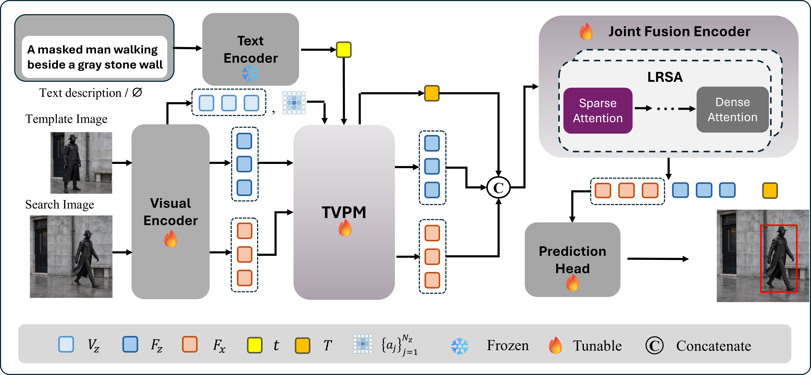
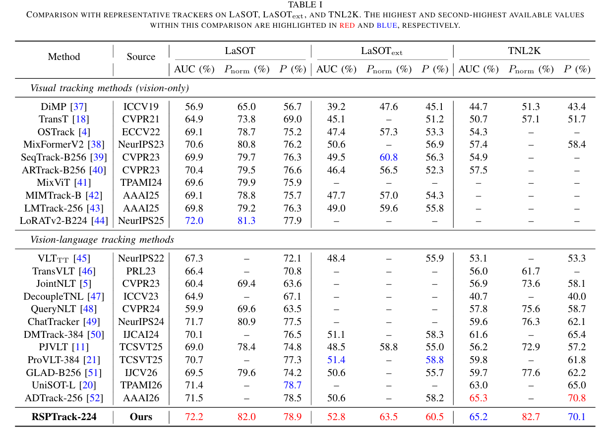

# RSPTrack: Language-Assisted Visual Tracking with Layer-wise Rectified Sparse Attention


## Overview

#### Our work

Visual object tracking is challenged by occlusion, appearance changes, and similar-object interference, while language annotations are often incomplete. Existing vision-language methods struggle with shared category attributes and unreliable local cues. We propose **RSPTrack**, integrating pre-fusion target-conditioned modulation with query-specific information selection during joint encoding. **TVPM** combines template appearance and text into latent role prompts to modulate representations without extra sequence length, and **LRSA** selects relevant key blocks per query while periodic dense attention restores global context.




#### Experimental Performance




## Installation

```bash
conda create -n rsptrack python=3.8 -y
conda activate rsptrack
pip install -r requirements.txt
```


## Usage

#### Data Preparation

Our RSPTrack is trained on LaSOT, TNL2K, RefCOCOg, GOT-10k, and TrackingNet datasets.
Put these tracking datasets in `./data`. It should look like:

```text
${RSPTrack_ROOT}
 -- data
     -- Lasot
         |-- airplane
         |-- basketball
         |-- bear
         ...
     -- GOT10k
         |-- test
         |-- train
         |-- val
     -- COCO
         |-- annotations
         |-- images
     -- Trackingnet
         |-- TRAIN_0
         |-- TRAIN_1
         ...
         |-- TEST
     -- TNL2K
         -- train
             |-- Arrow_Video_ZZ04_done
             |-- Assassin_video_1-Done
             |-- Assassin_video_2-Done
             ...
         -- test
             |-- advSamp_Baseball_game_002-Done
             |-- advSamp_Baseball_video_01-Done
             |-- advSamp_Baseball_video_02-Done
             ...

```

You can also use (which is what we use by default)：

```text
data/
├── Lasot_lmdb/
├── GOT10k_lmdb/
├── COCO_lmdb/
├── Trackingnet_lmdb/
├── TNL2K/
│   ├── train_set/
│   └── test_set/
```

`--use_lmdb 1` enables the use of LMDB for LaSOT, GOT-10k, COCO, and TrackingNet, while TNL2K continues to be read from the original files.


#### Set project paths

Run the following command to set paths for this project：

```bash
python tracking/create_default_local_file.py --workspace_dir . --data_dir ./data --save_dir ./output
```

This creates `local_paths.json` in the project root. Training, testing, and evaluation all read this file. 

`lib/project.py` defines the RSPTrack experiment defaults, and `lib/local_paths.py` provides the shared path settings. 


#### train

The backbone  of RSPTrack are initialized with pre-trained weights from [**Fast-iTPN**](https://github.com/sunsmarterjie/iTPN).
Please download the **fast_itpn_base_clipl_e1600.pt** and place them in `./pretrained/itpn` .

You can run the following command to train RSPTrack:

```bash
python tracking/train.py --script rsptrack --config RSPTrack-B --use_lmdb 1
```


#### test and evaluation

You can run the following command to test and evaluate RSPTrack:

- LaSOT：

```bash
python tracking/test.py rsptrack RSPTrack-B --dataset_name lasot
python tracking/analysis_results.py --config RSPTrack-B --dataset_name lasot
```

- LaSOT_ext：

```bash
python tracking/test.py rsptrack RSPTrack-B --dataset_name lasot_extension_subset
python tracking/analysis_results.py --config RSPTrack-B --dataset_name lasot_extension_subset
```

- TNL2K：

```bash
python tracking/test.py rsptrack RSPTrack-B --dataset_name tnl2k
python tracking/analysis_results.py --config RSPTrack-B --dataset_name tnl2k
```


## Model Zoo

The trained models, and the raw tracking results are provided in [Google Drive](https://drive.google.com/drive/folders/1EUg59VDlZFKopS3Ic3wISEg_cmYdt8ic?usp=sharing).


## Acknowledgement

Our work has been significantly inspired by the following open-source repositories: [SAVLT](https://github.com/zj5559/SAVLT), [SUTrack](https://github.com/chenxin-dlut/SUTrack), [Fast-iTPN](https://github.com/sunsmarterjie/iTPN) and [CoCoOP](https://github.com/KaiyangZhou/CoOp). We gratefully acknowledge the insights and foundations they provided, which have been instrumental in shaping this project.

